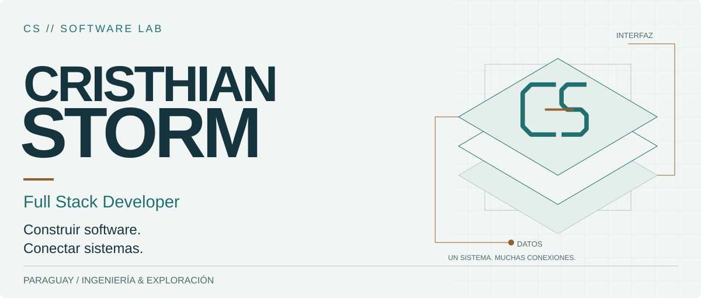
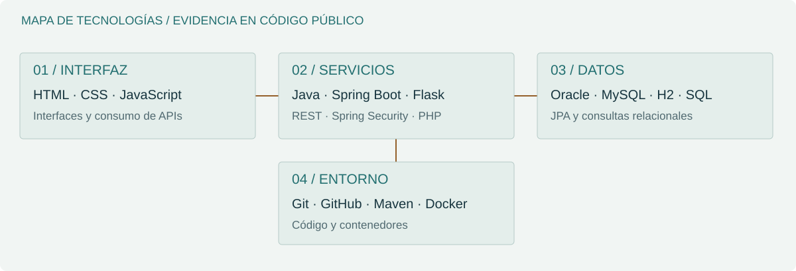
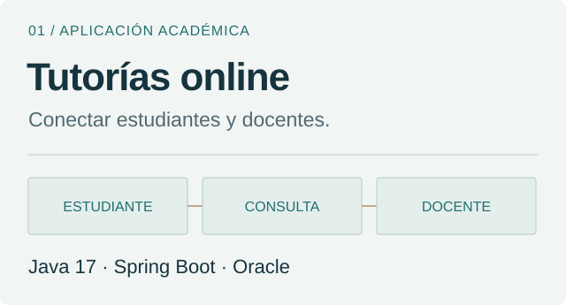
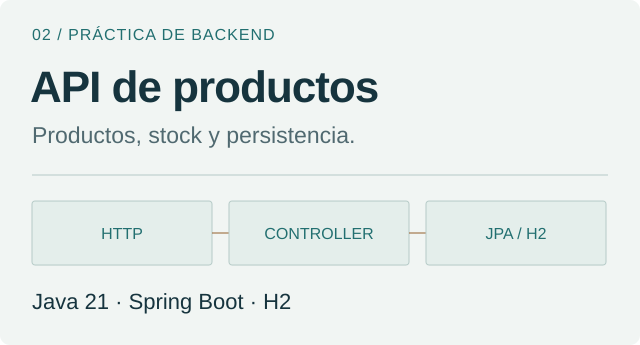
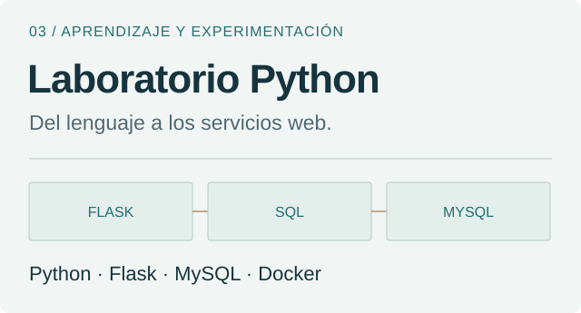
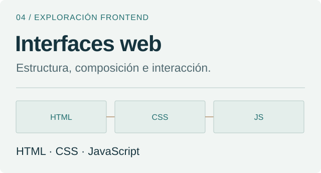

<picture>
  <source media="(max-width: 600px) and (prefers-color-scheme: dark)" srcset="./assets/lab/hero-dark-mobile.svg">
  <source media="(max-width: 600px)" srcset="./assets/lab/hero-light-mobile.svg">
  <source media="(prefers-color-scheme: dark)" srcset="./assets/lab/hero-dark.svg">
  
</picture>

[Identidad](#01--identidad) · [Ingeniería](#02--ingeniería) · [Proyectos](#03--proyectos) · [Exploración](#04--exploración) · [Contacto](#05--contacto)

## 01 / Identidad

Soy **Cristhian Storm**, desarrollador de software Full Stack y estudiante de Ingeniería Informática en Paraguay. Construyo aplicaciones web, servicios backend y soluciones que conectan interfaces con bases de datos.

Me interesa resolver problemas prácticos, automatizar procesos y mejorar sistemas existentes. Mi trabajo público reúne una aplicación de tutorías, una API de productos y laboratorios de programación.

## 02 / Ingeniería

<picture>
  <source media="(max-width: 600px) and (prefers-color-scheme: dark)" srcset="./assets/lab/stack-dark-mobile.svg">
  <source media="(max-width: 600px)" srcset="./assets/lab/stack-light-mobile.svg">
  <source media="(prefers-color-scheme: dark)" srcset="./assets/lab/stack-dark.svg">
  
</picture>

**Del navegador a los datos.** En [tutorías](https://github.com/CristhianStorm/Curso-sincronico/tree/main/src/main/java/com/gestion/emprendedora), el código separa controladores, servicios, repositorios JPA y entidades; algunos controladores también consultan repositorios directamente. Spring Security y un filtro JWT gestionan el acceso. En la [API de productos](https://github.com/CristhianStorm/java/tree/main/CrusoJava/curso_java-main/productoapi), el controlador REST usa el repositorio JPA directamente; existe un servicio que aún puede integrarse en ese flujo.

**Servicios pequeños, entornos reproducibles.** Las [prácticas de Python](https://github.com/CristhianStorm/Python/tree/main/Python/clase5) exploran Flask, un blueprint de login, consultas MySQL y Docker Compose. Son ejercicios educativos con configuración local que requiere adaptación.

El mapa representa tecnologías con evidencia en estos repositorios, sin porcentajes de dominio. [Consultar evidencias y alcance](./docs/EVIDENCE.md).

## 03 / Proyectos

<a href="https://github.com/CristhianStorm/Curso-sincronico">
<picture>
  <source media="(prefers-color-scheme: dark)" srcset="./assets/lab/tutorias-dark.svg">
  
</picture>
</a>

### Tutorías online

Conectar estudiantes y docentes. JWT y roles · Consultas · Foros · Informes PDF.

**Java 17 · Spring Boot · Oracle** · [Ver código y documentación →](https://github.com/CristhianStorm/Curso-sincronico)

<a href="https://github.com/CristhianStorm/java">
<picture>
  <source media="(prefers-color-scheme: dark)" srcset="./assets/lab/productos-dark.svg">
  
</picture>
</a>

### API de productos

Productos, stock y persistencia. CRUD · Validación de precio y stock · Estadísticas.

**Java 21 · Spring Boot · H2** · [Ver código y documentación →](https://github.com/CristhianStorm/java)

<a href="https://github.com/CristhianStorm/Python">
<picture>
  <source media="(prefers-color-scheme: dark)" srcset="./assets/lab/python-dark.svg">
  
</picture>
</a>

### Laboratorio Python

Del lenguaje a los servicios web. Blueprint de login · Swagger UI · Docker Compose.

**Python · Flask · MySQL · Docker** · [Ver código y documentación →](https://github.com/CristhianStorm/Python)

<a href="https://github.com/CristhianStorm/CristhianStorm.github.io">
<picture>
  <source media="(prefers-color-scheme: dark)" srcset="./assets/lab/web-dark.svg">
  
</picture>
</a>

### Interfaces web

Estructura, composición e interacción. Neo Jumper · Interfaz de acceso · Navegación.

**HTML · CSS · JavaScript** · [Ver código y documentación →](https://github.com/CristhianStorm/CristhianStorm.github.io)

Las tarjetas son diagramas conceptuales originales. Las funcionalidades descritas están presentes en el código; no implican un despliegue productivo ni una certificación de seguridad.

## 04 / Exploración

[**PHP y orientación a objetos**](https://github.com/CristhianStorm/PHP): arreglos, clases, constructores y herencia en ejercicios de aprendizaje.

También me interesan el desarrollo de videojuegos con Unity y C#, la automatización y el diseño UI/UX. Los presento como intereses y conocimientos declarados, sin atribuirles proyectos públicos que no están disponibles en este perfil.

## 05 / Contacto

[Explorar mis repositorios](https://github.com/CristhianStorm?tab=repositories) · [Portafolio web](https://cristhianstorm.github.io/)

Para conocer mi trabajo técnico, comenzá por **Tutorías online** y la **API de productos**. Encontrarás su alcance, estructura y requisitos en cada repositorio.

Read in English

I'm **Cristhian Storm**, a Full Stack software developer and Computer Engineering student in Paraguay. I build web applications and backend services that connect interfaces, application logic and relational data.

My public work includes an online tutoring application (Java 17, Spring Boot, Spring Security, JPA and Oracle), an educational product API (Java 21, Spring Boot and H2), Python/Flask/Docker exercises and web interface experiments. These repositories document the implementation and its limitations. Game development with Unity and C# is an additional interest, without a public project presented here as evidence.

[Explore the code](https://github.com/CristhianStorm?tab=repositories) · [Portfolio](https://cristhianstorm.github.io/)

---

**CS // SOFTWARE LAB** · Construir software. Conectar sistemas.
