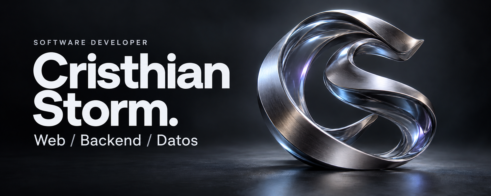

  <a href="#user-content-proyectos-seleccionados">Proyectos</a> &nbsp; / &nbsp;
  <a href="#user-content-tecnologías">Tecnologías</a> &nbsp; / &nbsp;
  <a href="https://github.com/CristhianStorm?tab=repositories">Explorar repositorios</a>

Soy **Cristhian**, desarrollador de software. Trabajo en aplicaciones web y servicios backend, conectando interfaces, lógica de negocio y bases de datos.

Me interesa entender el problema, construir una solución clara y mejorarla con cada iteración.

## Proyectos seleccionados

<table>
<tr>
<td width="50%" valign="top">

### Sistema de tutorías

Aplicación educativa para conectar estudiantes y docentes. Incluye autenticación JWT, roles, consultas, foros e informes de sesiones.

**Java 17 · Spring Boot · Spring Security · JPA**

[Explorar proyecto](https://github.com/CristhianStorm/Curso-sincronico)

</td>
<td width="50%" valign="top">

### API de productos

Práctica de backend con separación de responsabilidades entre controladores, servicios y repositorios.

**Java · Spring Boot · Maven**

[Explorar código](https://github.com/CristhianStorm/java/tree/main/CrusoJava/curso_java-main/productoapi)

</td>
</tr>
</table>

**Más código:** [Python y Docker](https://github.com/CristhianStorm/Python) · [Interfaces web](https://github.com/CristhianStorm/CristhianStorm.github.io) · [Prácticas de PHP](https://github.com/CristhianStorm/PHP)

## Tecnologías

**Backend:** Java · Spring Boot · Python · PHP  
**Web:** HTML · CSS · JavaScript  
**Datos:** SQL · Oracle · Spring Data JPA  
**Herramientas:** Git · GitHub · Maven · Docker

Read in English

I'm Cristhian, a software developer working on web applications and backend services. I enjoy connecting interfaces, application logic and databases.

My public work includes an online tutoring system, a product API, web interfaces and programming exercises with Java, Spring Boot, Python and PHP.

