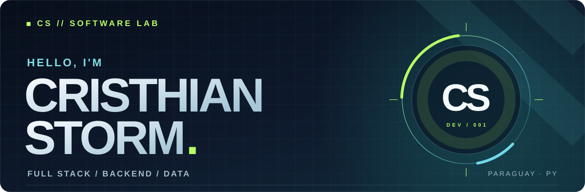

<!-- Perfil de GitHub de Cristhian Storm -->

<div align="center">
  

  <br />

  <a href="#proyectos-seleccionados"></a>
  <a href="https://github.com/CristhianStorm?tab=repositories"></a>
  <a href="#contacto"></a>

  <br /><br />

  <sub><b>DESARROLLO WEB</b> &nbsp;·&nbsp; <b>BACKEND</b> &nbsp;·&nbsp; <b>BASES DE DATOS</b> &nbsp;·&nbsp; <b>AUTOMATIZACIÓN</b></sub>
</div>

---

### `01 /` Sobre mí

Soy **Cristhian Storm**, desarrollador Full Stack y estudiante de **Ingeniería Informática en Paraguay**. Me gusta construir software que resuelva necesidades reales, desde una interfaz clara hasta la lógica del servidor y los datos que la sostienen.

- **Lo que hago:** aplicaciones web, APIs REST, integración de sistemas y consultas SQL.
- **Experiencia práctica:** desarrollo y soporte de sistemas académicos, automatización de procesos y generación de reportes.
- **Lo que busco mejorar:** arquitectura de software, rendimiento, experiencia de usuario y calidad del código.
- **También exploro:** desarrollo de videojuegos con Unity y C#.

### `02 /` Tecnologías

<div align="center">

**Lenguajes**

<picture>
  <source media="(prefers-reduced-motion: reduce)" srcset="./assets/technologies/languages-static.png" />
  
</picture>

**Frameworks y herramientas**

<picture>
  <source media="(prefers-reduced-motion: reduce)" srcset="./assets/technologies/frameworks-static.png" />
  
</picture>

**Bases de datos**

<picture>
  <source media="(prefers-reduced-motion: reduce)" srcset="./assets/technologies/databases-static.png" />
  
</picture>

</div>

<br />

<a name="proyectos-seleccionados"></a>

### `03 /` Proyectos seleccionados

<table>
  <tr>
    <td width="50%" valign="top">
      <h3>01. Plataforma de tutorías</h3>
      <p>Aplicación académica para conectar estudiantes y docentes, organizar tutorías y dar seguimiento a las sesiones.</p>
      <p><code>Java 17</code> <code>Spring Boot</code> <code>Spring Security</code> <code>Oracle</code></p>
      <p>Autenticación JWT, roles, foros, archivos adjuntos, reportes PDF e integración con Jitsi/JaaS.</p>
      <a href="https://github.com/CristhianStorm/Curso-sincronico"><b>Ver repositorio ↗</b></a>
    </td>
    <td width="50%" valign="top">
      <h3>02. API de productos</h3>
      <p>Servicio REST para administrar un catálogo de productos y practicar persistencia, validaciones y operaciones CRUD.</p>
      <p><code>Java 21</code> <code>Spring Boot</code> <code>JPA</code> <code>H2</code></p>
      <p>Gestión de productos, validación de precio y stock y estadísticas del catálogo.</p>
      <a href="https://github.com/CristhianStorm/java/tree/main/CrusoJava/curso_java-main/productoapi"><b>Explorar código ↗</b></a>
    </td>
  </tr>
  <tr>
    <td width="50%" valign="top">
      <h3>03. Python Lab</h3>
      <p>Laboratorio de ejercicios y pequeñas aplicaciones para explorar Python, servicios web y contenedores.</p>
      <p><code>Python</code> <code>Flask</code> <code>MySQL</code> <code>Docker</code></p>
      <p>APIs con Flask, login, Swagger UI, SQL y entornos con Docker Compose.</p>
      <a href="https://github.com/CristhianStorm/Python"><b>Ver prácticas ↗</b></a>
    </td>
    <td width="50%" valign="top">
      <h3>04. Web Experiments</h3>
      <p>Experimentos de interfaces y experiencias web para mejorar diseño, interacción y desarrollo frontend.</p>
      <p><code>HTML</code> <code>CSS</code> <code>JavaScript</code></p>
      <p>Proyectos visuales como Neo Jumper y una interfaz de acceso.</p>
      <a href="https://github.com/CristhianStorm/CristhianStorm.github.io"><b>Explorar interfaces ↗</b></a>
    </td>
  </tr>
</table>

<p align="center">
  <a href="https://github.com/CristhianStorm?tab=repositories"><b>Ver todos los repositorios →</b></a>
</p>

### `04 /` En qué estoy enfocado

```text
BUILDING   →  Aplicaciones web y servicios backend
LEARNING   →  Arquitectura, automatización y UI/UX
EXPLORING  →  Unity, C# y diseño de videojuegos
```

<a name="contacto"></a>

### `05 /` Contacto

<div align="center">
  <p>¿Tenés una idea, un proyecto o simplemente querés hablar de tecnología?</p>
  <a href="https://github.com/CristhianStorm"></a>
  <br /><br />
  <sub>Diseñado y desarrollado con curiosidad desde Paraguay 🇵🇾</sub>
</div>
