  <b>Desarrollo aplicaciones que conectan interfaces, lógica y datos.</b> 
  Aprendo construyendo y mejoro cada proyecto paso a paso.

  <a href="#user-content-proyectos">Proyectos</a> &nbsp; · &nbsp;
  <a href="#user-content-tecnologías">Tecnologías</a> &nbsp; · &nbsp;
  <a href="https://github.com/CristhianStorm?tab=repositories">Todos los repositorios</a>

## Proyectos

<table>
<tr>
<td width="50%" valign="top">

Autenticación JWT, roles, consultas, foros e informes de sesiones.

[Ver sistema de tutorías](https://github.com/CristhianStorm/Curso-sincronico)

</td>
<td width="50%" valign="top">

Práctica de backend con controladores, servicios y repositorios.

[Ver API de productos](https://github.com/CristhianStorm/java/tree/main/CrusoJava/curso_java-main/productoapi)

</td>
</tr>
<tr>
<td width="50%" valign="top">

Ejercicios de lógica, servicios web, consultas SQL y entornos Docker.

[Ver laboratorio de Python](https://github.com/CristhianStorm/Python)

</td>
<td width="50%" valign="top">

Prácticas de interfaces web y programación del lado del servidor.

[Ver interfaces](https://github.com/CristhianStorm/CristhianStorm.github.io) · [Ver PHP](https://github.com/CristhianStorm/PHP)

</td>
</tr>
</table>

## Tecnologías

<b>Backend</b>

Java · Spring Boot · Python · PHP

<b>Frontend</b>

HTML · CSS · JavaScript

<b>Herramientas y datos</b>

Git · GitHub · Maven · Docker SQL · Oracle · Spring Data JPA

### En lo que sigo profundizando

Diseño de APIs, autenticación, persistencia y organización del código.

Read in English

I'm Cristhian, a software developer building web applications and backend projects with Java, Spring Boot, Python and PHP. My public repositories include an online tutoring system, a product API, web interfaces and programming exercises.

I enjoy connecting interfaces, application logic and data, learning by building and improving each solution.

 

