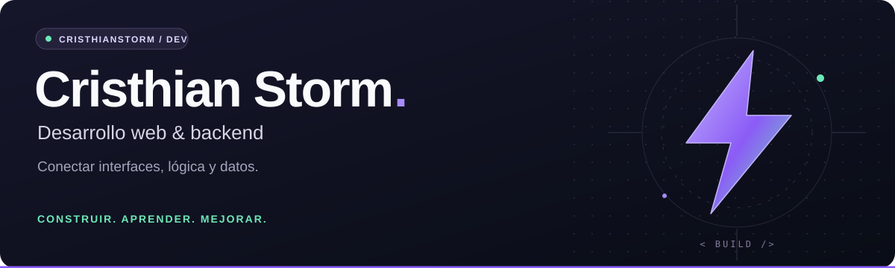

  

  <b>Hola, soy Cristhian 👋</b> 
  Desarrollo aplicaciones web y exploro el backend con Java, Python y PHP. 
  Me gusta entender cómo funcionan las cosas y convertir lo aprendido en proyectos.

  <a href="#-proyectos-destacados">Proyectos</a> &nbsp;·&nbsp;
  <a href="#-tecnologías">Tecnologías</a> &nbsp;·&nbsp;
  <a href="https://github.com/CristhianStorm?tab=repositories">Todos mis repositorios</a>

---

### ⚡ Sobre mí

- Construyo proyectos que conectan interfaces, lógica de negocio y datos.
- Mi trabajo público incluye un sistema de tutorías, una API de productos y prácticas de programación.
- Aprendo creando: desarrollo, pruebo y mejoro cada solución paso a paso.

### 🧰 Tecnologías

| Área | Tecnologías presentes en mis proyectos |
| :--- | :--- |
| **Frontend** | HTML · CSS · JavaScript |
| **Backend** | Java · Spring Boot · Python · PHP |
| **Datos y persistencia** | SQL · Spring Data JPA |
| **Herramientas** | Git · GitHub · Maven · Docker |

### 🚀 Proyectos destacados

<table>
<tr>
<td width="50%" valign="top">

#### 🎓 Sistema de tutorías online
Aplicación para gestionar tutorías, con autenticación, roles, consultas, foros y generación de informes.

**Java 17 · Spring Boot · Spring Security · JPA**

[Explorar el proyecto →](https://github.com/CristhianStorm/Curso-sincronico)

</td>
<td width="50%" valign="top">

#### 📦 API de productos
Proyecto de práctica con controladores, servicios y repositorios para organizar una API en capas.

**Java · Spring Boot · Maven**

[Explorar el proyecto →](https://github.com/CristhianStorm/java/tree/main/CrusoJava/curso_java-main/productoapi)

</td>
</tr>
<tr>
<td width="50%" valign="top">

#### 🐍 Laboratorio de Python
Ejercicios y prácticas de lógica, funciones, aplicaciones web y entornos con Docker.

**Python · SQL · Docker**

[Explorar el proyecto →](https://github.com/CristhianStorm/Python)

</td>
<td width="50%" valign="top">

#### 🌐 Desarrollo web
Interfaces y prácticas con HTML, CSS y JavaScript, junto con ejercicios de PHP.

**HTML · CSS · JavaScript · PHP**

[Interfaces web →](https://github.com/CristhianStorm/CristhianStorm.github.io) &nbsp;·&nbsp; [Prácticas PHP →](https://github.com/CristhianStorm/PHP)

</td>
</tr>
</table>

### 🌱 Lo que sigo explorando

Diseño de APIs, autenticación, organización del código y conexión de aplicaciones con bases de datos.

---

  <b>Construir. Aprender. Mejorar.</b> Gracias por visitar mi perfil.

