<!-- CS // SOFTWARE LAB — Perfil de GitHub de Cristhian Storm -->

  <picture>
    <source media="(prefers-reduced-motion: reduce)" srcset="./assets/identity/hero.svg" />
    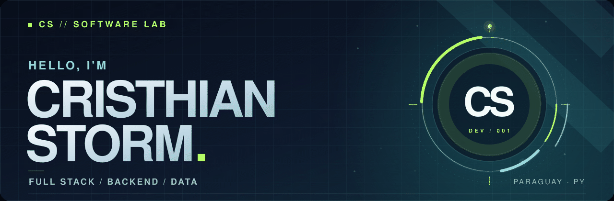
  </picture>
  

    
    
    
  

---

## `01 /` Hola, soy Cristhian

Soy desarrollador **Full Stack** y estudiante de **Ingeniería Informática en Paraguay**. Disfruto convertir necesidades reales en herramientas útiles: desde la interfaz que utiliza una persona hasta los servicios y las bases de datos que hacen funcionar todo.

En mi experiencia práctica trabajo con **sistemas académicos, consultas SQL, reportes y automatización de procesos**. Me interesa especialmente mejorar aplicaciones existentes y hacer que el software sea más claro, confiable y fácil de usar.

  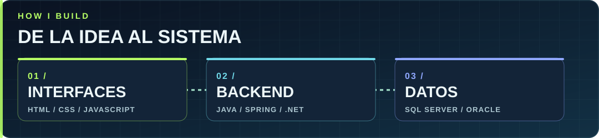

## `02 /` Mi stack tecnológico

Lenguajes y herramientas con los que he trabajado en proyectos, prácticas y desarrollo de sistemas.

**Lenguajes**

<picture>
  <source media="(prefers-reduced-motion: reduce)" srcset="./assets/technologies/languages-static.png" />
  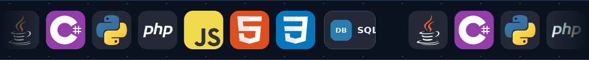
</picture>

**Backend y frameworks**

<picture>
  <source media="(prefers-reduced-motion: reduce)" srcset="./assets/technologies/frameworks-static.png" />
  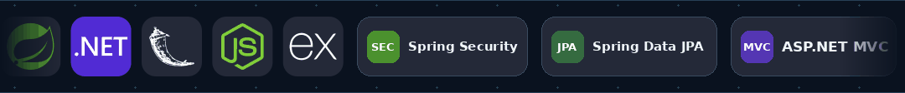
</picture>

**Interfaces y videojuegos**

<picture>
  <source media="(prefers-reduced-motion: reduce)" srcset="./assets/technologies/ui-static.png" />
  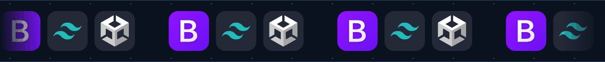
</picture>

**Bases de datos**

<picture>
  <source media="(prefers-reduced-motion: reduce)" srcset="./assets/technologies/databases-static.png" />
  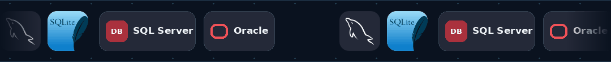
</picture>

**Reportes, herramientas e integraciones**

<picture>
  <source media="(prefers-reduced-motion: reduce)" srcset="./assets/technologies/tools-static.png" />
  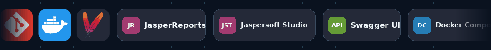
</picture>

> **Área de experiencia práctica:** generación de reportes académicos con **JasperReports / Jaspersoft Studio**, consultas SQL Server y Oracle, integración de datos y desarrollo de sistemas internos.

## `03 /` Proyectos seleccionados

Estos son algunos proyectos públicos que muestran cómo trabajo con desarrollo web, servicios backend y aprendizaje práctico.

<table>
  <tr>
    <td width="50%" valign="top">
      <a href="https://github.com/CristhianStorm/Curso-sincronico">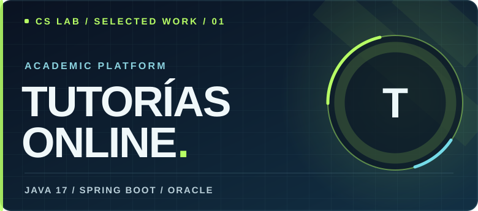</a>
      
Plataforma académica con autenticación JWT, roles, foros, archivos adjuntos, reportes PDF e integración con Jitsi/JaaS.

      
<a href="https://github.com/CristhianStorm/Curso-sincronico"><b>Explorar proyecto ↗</b></a>

    </td>
    <td width="50%" valign="top">
      <a href="https://github.com/CristhianStorm/java/tree/main/CrusoJava/curso_java-main/productoapi">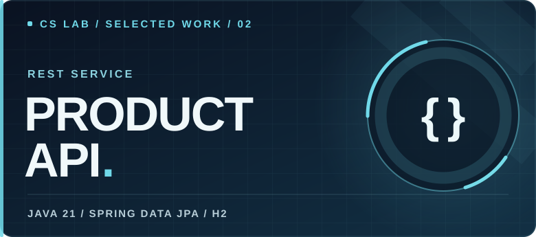</a>
      
API REST de catálogo con operaciones CRUD, validaciones de precio y stock, persistencia JPA y estadísticas.

      
<a href="https://github.com/CristhianStorm/java/tree/main/CrusoJava/curso_java-main/productoapi"><b>Explorar proyecto ↗</b></a>

    </td>
  </tr>
  <tr>
    <td width="50%" valign="top">
      <a href="https://github.com/CristhianStorm/Python">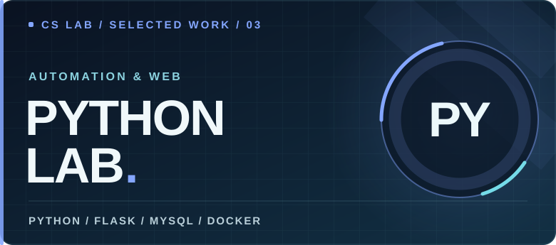</a>
      
Laboratorio de Python con Flask, autenticación, Swagger UI, consultas MySQL y entornos con Docker Compose.

      
<a href="https://github.com/CristhianStorm/Python"><b>Explorar prácticas ↗</b></a>

    </td>
    <td width="50%" valign="top">
      <a href="https://github.com/CristhianStorm/CristhianStorm.github.io">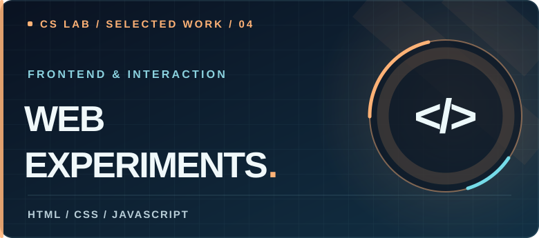</a>
      
Experimentos con HTML, CSS y JavaScript: interfaces, interacciones visuales y proyectos como Neo Jumper.

      
<a href="https://github.com/CristhianStorm/CristhianStorm.github.io"><b>Ver interfaces ↗</b></a>

    </td>
  </tr>
</table>

  

## `04 /` Más allá de estos proyectos

- **Ingeniería y arquitectura:** organización del código, APIs, seguridad y diseño de sistemas.
- **Automatización y datos:** consultas SQL, integración de información y reportes.
- **Diseño y creatividad:** UI/UX, prototipos y desarrollo de videojuegos con Unity y C#.

También podés ver mis [prácticas de PHP y programación orientada a objetos](https://github.com/CristhianStorm/PHP).

## `05 /` Conectemos

  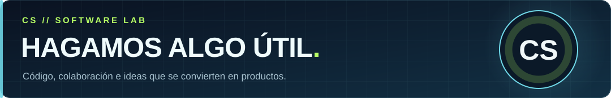
  
¿Tenés un proyecto, una idea o querés conversar sobre tecnología?

  

  
Read in English

  
I'm <b>Cristhian Storm</b>, a Full Stack developer and Computer Engineering student in Paraguay. I work with web applications, backend services, relational databases and academic systems. My public projects include an online tutoring platform, a product REST API, Python experiments and frontend interfaces. I'm also interested in software architecture, UI/UX, automation and game development.

CS // SOFTWARE LAB · Built with curiosity in Paraguay 🇵🇾

