<a href="#user-content-sobre-mí">Sobre mí</a> &nbsp; / &nbsp;
<a href="#user-content-tecnologías">Tecnologías</a> &nbsp; / &nbsp;
<a href="#user-content-proyectos">Proyectos</a> &nbsp; / &nbsp;
<a href="https://github.com/CristhianStorm?tab=repositories">Repositorios</a>

## Sobre mí

Soy **Cristhian**, desarrollador de software. Me interesa lo que pasa entre una interfaz y sus datos: las reglas, los servicios y las conexiones que hacen funcionar una aplicación.

Mi trabajo público incluye un sistema de tutorías, una API de productos y prácticas de desarrollo web. Aprendo construyendo, entendiendo cada pieza y mejorando el código paso a paso.

## Tecnologías

<table>
<tr><td><b>Backend</b></td><td> Java · Spring Boot · Python · PHP</td></tr>
<tr><td><b>Frontend</b></td><td> HTML · CSS · JavaScript</td></tr>
<tr><td><b>Datos</b></td><td>SQL · Oracle · Spring Data JPA</td></tr>
<tr><td><b>Herramientas</b></td><td> Git · GitHub · Maven · Docker</td></tr>
</table>

## Proyectos

| Proyecto | Qué contiene | Tecnologías |
| :--- | :--- | :--- |
| **[Sistema de tutorías](https://github.com/CristhianStorm/Curso-sincronico)** | Autenticación JWT, roles, consultas, foros e informes de sesiones. | Java 17 · Spring Boot · Security · JPA |
| **[API de productos](https://github.com/CristhianStorm/java/tree/main/CrusoJava/curso_java-main/productoapi)** | Práctica de backend organizada en controladores, servicios y repositorios. | Java · Spring Boot · Maven |
| **[Laboratorio de Python](https://github.com/CristhianStorm/Python)** | Lógica, servicios web, consultas SQL y entornos Docker. | Python · SQL · Docker |
| **[Interfaces web](https://github.com/CristhianStorm/CristhianStorm.github.io)** | Prácticas de estructura, estilos y programación en el navegador. | HTML · CSS · JavaScript |
| **[Prácticas de PHP](https://github.com/CristhianStorm/PHP)** | Ejercicios de lógica y programación del lado del servidor. | PHP · HTML |

### En desarrollo constante

Sigo profundizando en diseño de APIs, autenticación, persistencia y organización del código.

Read in English

I'm Cristhian, a software developer interested in the connections between interfaces, application logic and data. I build web and backend projects with Java, Spring Boot, Python and PHP.

My public work includes an online tutoring system, a product API, web interfaces and programming exercises. I learn by building, understanding each part and improving it step by step.

<b>Entender. Construir. Evolucionar.</b> <a href="https://github.com/CristhianStorm?tab=repositories">Explorar todos mis repositorios</a>

