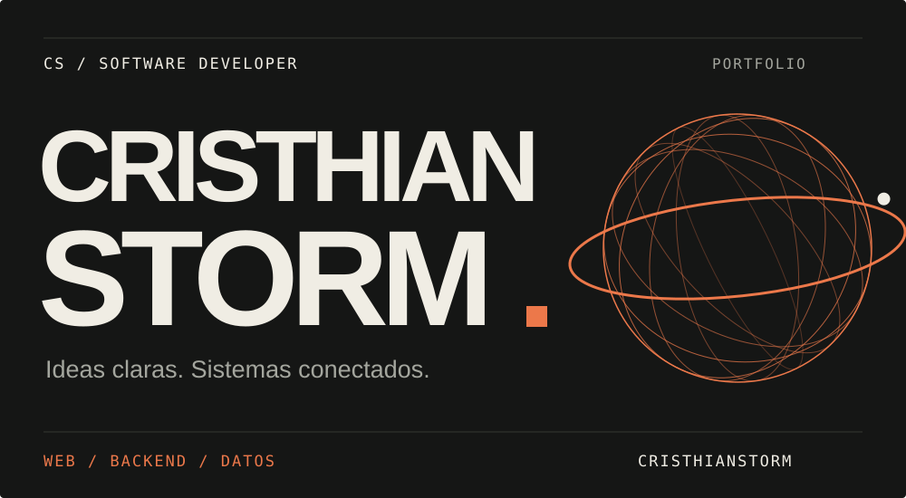
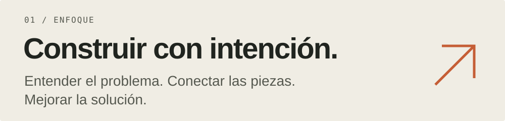
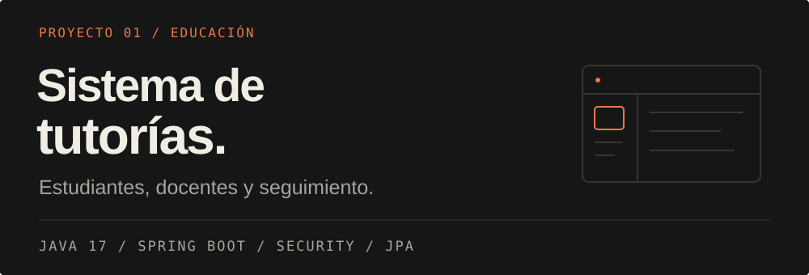
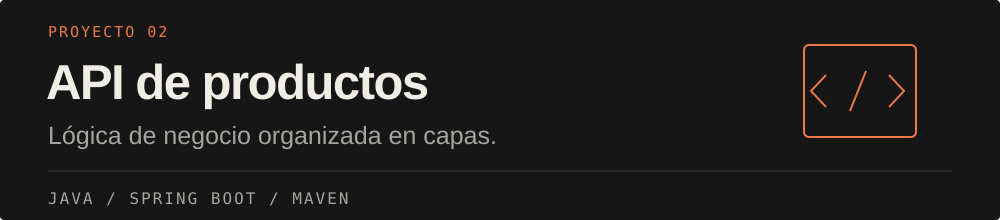
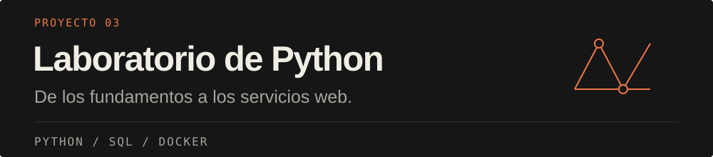
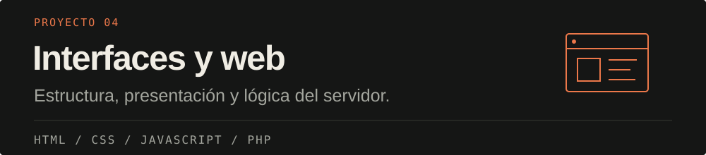
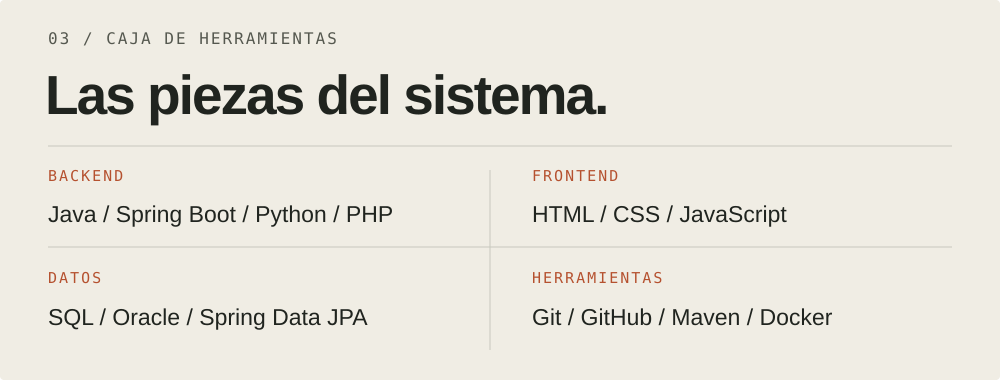
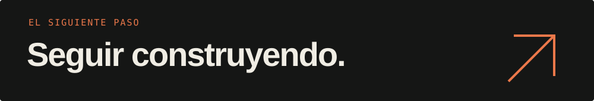

  <a href="#proyectos">PROYECTOS</a> &nbsp; / &nbsp;
  <a href="#tecnologías">TECNOLOGÍAS</a> &nbsp; / &nbsp;
  <a href="https://github.com/CristhianStorm?tab=repositories">REPOSITORIOS</a>

Soy **Cristhian**, desarrollador de software. Construyo aplicaciones web y proyectos de backend que conectan interfaces, lógica de negocio y datos.

## Proyectos

Una selección de mi trabajo público. Cada pieza lleva a su código.

Autenticación con JWT, gestión de roles, consultas, foros, archivos adjuntos e informes de sesiones.

[Explorar sistema de tutorías](https://github.com/CristhianStorm/Curso-sincronico)

Práctica de backend con separación en controladores, servicios y repositorios.

[Explorar API de productos](https://github.com/CristhianStorm/java/tree/main/CrusoJava/curso_java-main/productoapi)

Ejercicios de lógica, servicios web, consultas SQL y entornos con Docker.

[Explorar laboratorio de Python](https://github.com/CristhianStorm/Python)

Prácticas de interfaces en el navegador y programación del lado del servidor.

[Explorar interfaces](https://github.com/CristhianStorm/CristhianStorm.github.io) &nbsp; / &nbsp; [Explorar PHP](https://github.com/CristhianStorm/PHP)

## Tecnologías

Herramientas presentes en mis proyectos públicos. Sigo profundizando en diseño de APIs, autenticación, persistencia y organización del código.

Read in English

I'm Cristhian, a software developer building web applications and backend projects. I work with Java, Spring Boot, Python and PHP, connecting user interfaces, application logic and data.

My public work includes an online tutoring system, a product API, web interfaces and programming exercises. I learn by building, understanding the problem and improving each solution.

 

